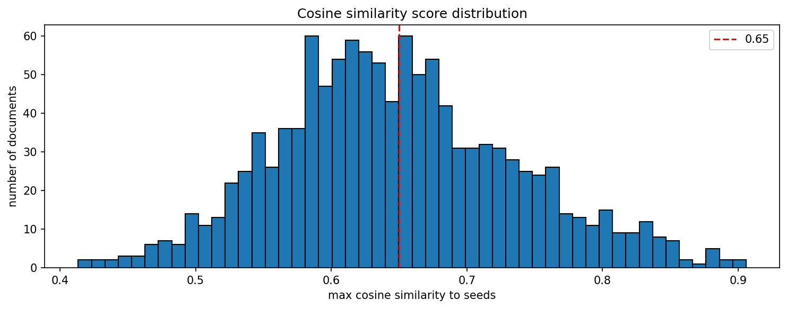

# filter run log

| | |
|---|---|
| date | 2026-10-16 |
| input file | `s:\stbuchho\crises_and_welfare_states\policy-tracker\data\raw\germany\bgbl1_2016-2018_20260918.json` |
| output dir | `s:\stbuchho\crises_and_welfare_states\policy-tracker\data\processed\germany\pre2023` |
| output prefix | `germany_2016-2018` |

## configuration

| parameter | value |
|---|---|
| AUTO_THRESHOLD | 0.765 |
| BORDERLINE_LOW | 0.735 |

## score distribution

| metric | value |
|---|---|
| min | 0.413 |
| max | 0.906 |
| mean | 0.648 |
| median | 0.640 |

## filtering results

| category | n |
|---|---|
| auto-accepted (>= 0.765) | 120 |
| borderline (0.735–0.764) | 75 |
| below threshold (< 0.735) | 970 |
| total | 1165 |

## output files

- `s:\stbuchho\crises_and_welfare_states\policy-tracker\data\processed\germany\pre2023\germany_2016-2018_cosinesim_auto_accepted.json`
- `s:\stbuchho\crises_and_welfare_states\policy-tracker\data\processed\germany\pre2023\germany_2016-2018_cosinesim_borderline_candidates.json`
